# Contract Architecture

UltraYield V2 is a UUPS-upgradeable, ERC-7540-style async-redeem vault priced by a deterministic on-chain oracle. The core is split into one abstract mechanics base and thin concrete variants that add regulatory gating, with heavy logic factored into external libraries and an external upgrade module to keep proxy bytecode in bounds.

## Inheritance diagram

```mermaid
flowchart TD
    CompliantUltraVault --> UltraVault
    AllowlistUltraVault --> UltraVault
    UltraVault[UltraVault &#40;abstract&#41;] --> BaseControlledAsyncRedeem

    BaseControlledAsyncRedeem --> AccessControl
    BaseControlledAsyncRedeem --> ERC4626
    BaseControlledAsyncRedeem --> Pausable
    BaseControlledAsyncRedeem --> AddressUpdatable
    BaseControlledAsyncRedeem --> UUPSUpgradeable
    BaseControlledAsyncRedeem --> RedeemQueue

    RedeemQueue -. DELEGATECALL .-> RedeemQueueLib
    BaseControlledAsyncRedeem -. _authorizeUpgrade .-> TimelockedUpgradeModule
    CompliantUltraVault -. DELEGATECALL .-> ComplianceLib
    AllowlistUltraVault -. DELEGATECALL .-> ComplianceLib

    UltraVaultFactory -. deploys ERC1967 proxy .-> CompliantUltraVault
    UltraVaultFactory -. deploys ERC1967 proxy .-> AllowlistUltraVault
```

## Inheritance and responsibility split

`UltraVault` is now `abstract`: it holds all shared mechanics (oracle pricing, fees, instant redeem, `fundsHolder` custody) with **no access gating of its own**. Deploy a concrete variant instead — `CompliantUltraVault` (deny-list freeze model) or `AllowlistUltraVault` (allow-list model). See [Compliance](COMPLIANCE.md).

- `BaseControlledAsyncRedeem` provides the ERC-7540 controlled async redeem flow: deposit/mint, request/cancel/fulfill redeem, claim (`withdraw`/`redeem`), operator approvals (`setOperator`), multi-asset conversion via the rate provider, pause control, the key-based address registry, and UUPS upgrade authorization delegated externally.
- `UltraVault` adds: assets held on `fundsHolder` (deposits route straight to custody), oracle-driven `totalAssets`, the fee engine, and instant redeem out of a separate `instantRedeemExitpoint`.
- The concrete variants override the `virtual` gating hooks. `CompliantUltraVault` overrides all five (`_beforeDeposit`, `_beforeWithdraw`, `_beforeInstantRedeem`, `_canReceiveShares`, `_canInstantRedeem`); `AllowlistUltraVault` overrides only the first four and leaves `_canInstantRedeem` at its base default (returns `true`), so a non-allowlisted controller can still instant-redeem to itself. Both variants additionally override the ERC-20 `_update` transfer hook — the chokepoint that confines share ownership — and `CompliantUltraVault` also overrides `_handleRedeemRequestCancelation`.

## ERC-7201 storage

Every module owns a namespaced ERC-7201 storage struct at a fixed slot, so layouts stay upgrade-safe and disjoint: `UltraVaultStorage` (fees, `feeRecipient`), `BaseAsyncRedeemStorage` (`isOperator`), `RedeemQueue`'s `REDEEM_QUEUE_STORAGE_LOCATION`, `AddressUpdatable`'s registry, and `ComplianceLib`'s `COMPLIANCE_STORAGE_LOCATION`. A handful of V1 slots (`_fundsHolder`, `_oracle`, `_rateProvider`, …) are deprecated and retained only for layout compatibility and V1-migration detection.

## Core modules

- **User entry points**: `deposit`/`mint` (and `…WithReferral` / multi-asset `depositAsset`/`mintWithAsset`), `requestRedeem`, `cancelRedeemRequest`, `withdraw`/`redeem`, `instantRedeem`.
- **Redeem accounting**: pending vs claimable per `(controller, asset)` via `RedeemQueue`.
- **Asset conversion**: base asset ↔ supported assets through `rateProvider()` (`convertToUnderlying`/`convertFromUnderlying` with an `Adjustment`). See [Rate Providers](RATE_PROVIDERS.md).
- **Valuation**: a single 1e18 share price from `oracle().currentSharePrice()`; `totalAssets() = convertToAssets(totalSupply())`. See [Oracles](ORACLES.md).
- **Fee engine**: management/performance/withdrawal fees plus an instant-redeem premium, in `UltraVault`. See [Economics](ECONOMICS.md).

## Async redeem data model

The redeem lifecycle keeps two states per `(controller, asset)`, with a single bucket (`requestId` is always `0`):

- **Pending**: created by `requestRedeem`, which pulls the owner's shares into the vault (not yet burned) and stamps `requestTime`. Each request records a per-bucket `autoClaim` preference (last-writer-wins).
- **Claimable**: created at fulfillment. `fulfillMultipleRedeems` (`OPERATOR_ROLE`) converts shares to the requested asset, deducts the withdrawal fee, records the owed `(assets, shares)`, and burns the shares. If `autoClaim` was set, proceeds are delivered in the same transaction.
- **Claim**: `withdraw`/`redeem` consume claimable balances and transfer assets out. Claims work even while paused; asset→share math rounds up and share→asset rounds down. `previewWithdraw`/`previewRedeem` revert (unsupported for async).

This separates batched operational settlement from on-chain user claim accounting. See [Flows](FLOWS.md).

## External-module and library architecture

To stay under the proxy bytecode limit, two libraries live outside the vault and are reached by `DELEGATECALL`:

- `RedeemQueueLib` — public queue functions deployed once; `RedeemQueue` is a thin wrapper of internal JUMP targets sharing the same ERC-7201 slot.
- `ComplianceLib` — holds both the freeze list and the deposit allowlist in one canonical namespace shared across variants (access control stays in the calling vault).

A third external contract, `TimelockedUpgradeModule`, is **not** a delegatecall target — see below. The upgrader calls it directly, and `executeUpgrade` performs a normal external call into the vault via `upgradeToAndCall`; the vault never delegatecalls into the module.

## Address registry and upgrade delegation

`AddressUpdatable` replaces V1's per-field setters with one timelocked registry keyed by `bytes32` (`FUNDS_HOLDER_KEY`, `ORACLE_KEY`, `RATE_PROVIDER_KEY`, `INSTANT_REDEEM_EXITPOINT_KEY`, `UPGRADE_MODULE_KEY`, `FREEZE_REGISTRY_KEY`). Changes flow through `proposeAddressUpdate` → per-key timelock → `acceptAddressUpdate`; accepting **pauses** the vault so operators can verify before reopening.

Upgrades are delegated: `_authorizeUpgrade` requires `msg.sender == upgradeModule()`, and the external `TimelockedUpgradeModule` enforces a 7-day timelock plus `UPGRADER_ROLE` (read from the vault). The module address is itself an updatable registry entry. New proxies are created by `UltraVaultFactory`, a CREATE2 deployer with a registered-version registry. See [Factory](FACTORY.md) and [Upgrades](UPGRADES.md).
