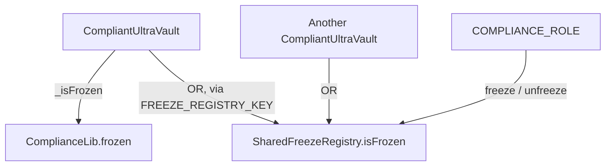

# Compliance and Allowlist Vaults

In V2 `UltraVault` is an `abstract` base: its share-movement and lifecycle hooks (`_beforeDeposit`, `_beforeWithdraw`, `_beforeInstantRedeem`, `_canReceiveShares`, `_canInstantRedeem`, `_update`) are `virtual`. Regulated deployments use one of two concrete subclasses that specialize those hooks. `UltraVault` itself is no longer directly deployable — a proxy is one variant or the other.

- **`CompliantUltraVault`** — a deny-list model: freeze individual addresses, force-burn their shares, and honor an optional shared registry on top of a local list.
- **`AllowlistUltraVault`** — an allow-list model: share ownership and third-party redemption proceeds are confined to allowlisted wallets, with enforcement ON by default.

There is no combined freeze+allowlist contract; the two are sibling subclasses. Roles referenced here are defined alongside the rest in [Roles, Permissions, and Operations](PERMISSIONS.md); the gated flows are detailed in [Flows](FLOWS.md).

## Shared storage: `ComplianceLib`

Both variants persist their state through the external library `ComplianceLib` (`src/utils/ComplianceLib.sol`), reached via `DELEGATECALL` to keep vault bytecode small. It holds **both** lists in one ERC-7201 struct at namespace `ultrayield.storage.Compliance` (slot `COMPLIANCE_STORAGE_LOCATION`):

- `mapping(address => bool) frozen`
- `mapping(address => bool) allowlisted`
- `bool allowlistDisabled` — a **negated** flag, so the zero-value (`false`) means enforcement is **enabled**; a fresh deployment fails safe.

The allowlist fields are appended after `frozen` and must never be reordered, so the layout stays canonical and upgrade-safe across both variants. All mutators are idempotent — they write and emit only on an actual state change. `ComplianceLib` has no access control and does not gate the zero address; role checks and sentinel handling live in the calling vault.

## `CompliantUltraVault`

`src/vaults/CompliantUltraVault.sol`, gated by `COMPLIANCE_ROLE`:

- `freeze` / `freezeBatch` / `unfreeze` — emit `AccountFrozen` / `AccountUnfrozen`.
- `forceBurn(target, amount)` — `_burn`s the target's wallet shares and emits `ForceBurned`; pending and claimable redeems are untouched.
- `isFrozen(account)` — the effective state, **local list OR shared registry**.

The shared registry is consulted through `IFreezeRegistry` at `FREEZE_REGISTRY_KEY` (`src/utils/AddressKeys.sol`). It is **authoritative and cannot be locally overridden** (additive OR); when none is configured the lookup is skipped (local-only). A configured registry is a hard dependency — if its `isFrozen` reverts, the caller reverts.

Gating uses `_ensureNotFrozen`, which **returns early on `address(0)`** so mint/burn sentinels need no special-casing. On withdraw and instant redeem the receiver is checked, and the controller too when it differs from the receiver. On redeem-request cancellation the controller is checked unconditionally and the receiver is gated by `_update` on the shares returned from the vault. The depositor (`msg.sender`) is checked on deposit/mint. Every share movement runs through `_update`: the recipient is always checked, and the sender is checked unless `to == address(0)` — that burn exemption is exactly what lets `forceBurn` destroy a frozen address's shares. A frozen receiver's `maxDeposit`/`maxMint` collapse to 0 via `_canReceiveShares`; a frozen controller's `maxInstantRedeem` is 0 via `_canInstantRedeem` (even a self-redeem is rejected).

## `AllowlistUltraVault`

`src/vaults/AllowlistUltraVault.sol`. Membership is gated by `ALLOWLIST_ROLE`:

- `addToAllowlist` / `addToAllowlistBatch` / `removeFromAllowlist` — emit `AccountAllowed` / `AccountDisallowed`. (Only the add path has a batch variant.)
- `isAllowed(account)` and `isAllowlistEnabled()` (returns `!allowlistDisabled`).

The master switch `setAllowlistEnabled(bool)` is **`onlyOwner`** (not `ALLOWLIST_ROLE`), emits `AllowlistEnabledSet`, and when set to `false` lifts every check. Enforcement is ON by default.

Gating uses `_ensureAllowlisted` (reverts `NotAllowlisted`). The depositor is checked on deposit/mint; on withdraw and instant redeem only the recipient is checked **and only when it differs from the controller**, so self-exit always stays open — a de-listed holder can still redeem to itself. Every share movement runs through `_update`, gating every recipient except burns (`to == address(0)`) and escrow into the vault itself (`to == address(this)`). All other recipients — including the fee recipient and bootstrap users — must be allowlisted (ensured operationally). The net invariant: **shares can only ever land on allowlisted wallets**. A non-allowlisted receiver's `maxDeposit`/`maxMint` are 0 via `_canReceiveShares`.

## `SharedFreezeRegistry`

`src/registry/SharedFreezeRegistry.sol` is a standalone, **non-upgradeable** `AccessControl` contract implementing `IFreezeRegistry`. An address is frozen once here and honored by every `CompliantUltraVault` pointed at it; vaults OR this registry into their checks and **never write to it**. Its `constructor(admin)` grants `DEFAULT_ADMIN_ROLE` (which administers `COMPLIANCE_ROLE` membership); `freeze` / `freezeBatch` / `unfreeze` are gated by `COMPLIANCE_ROLE`.

Unlike `ComplianceLib`, the registry **hard-rejects the zero address** (`ZeroAddress()`) on freeze and unfreeze, since the zero address is the ERC20 mint/burn sentinel and freezing it could brick those flows. The constructor rejects a zero admin (`ZeroAdminAddress()`). Rotating the registry means deploying a new one and re-pointing vaults.

## Wiring the registry

The registry address lives in `UltraVault`'s key-based registry under `FREEZE_REGISTRY_KEY`, not a bespoke setter. It is seeded in `initialize` / `initializeV2(exitpoint, upgradeModule, freezeRegistry)`, and later changes go through the generic `proposeAddressUpdate` / `acceptAddressUpdate` guarded by `FREEZE_REGISTRY_TIMELOCK` (3 days). A zero address there means local-only freeze. Only `CompliantUltraVault` reads this key; `AllowlistUltraVault` has no registry concept.

All compliance, allowlist, freeze, and force-burn functionality is net-new in V2 — there is no V1 predecessor to migrate from.
