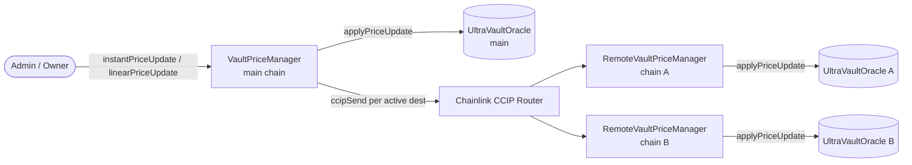
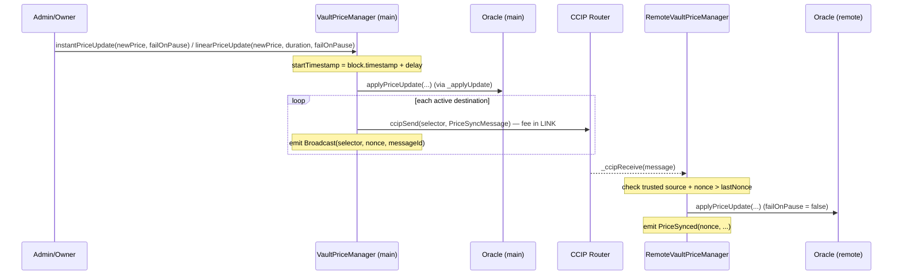

# Cross-Chain Pricing (CCIP)

## Why cross-chain pricing exists

An UltraYield vault may be deployed on several chains while one share price must govern all of them. Rather than running an independent price feed per chain (which would drift), the system authors **one canonical share price on a main chain** and mirrors it to every remote chain over Chainlink CCIP.

The trick that makes this safe is determinism: the price is not a stored number that must arrive intact, it is a curve. Each update carries a `startTimestamp`, `startPrice`, `targetPrice`, and `vestingDuration`, and the oracle (`UltraVaultOracle`) interpolates the live price as a pure function of `block.timestamp`. The same update, evaluated at the same timestamp on any chain running identical bytecode, therefore yields the same price — so every chain prices off one shared update log, not an independent feed. This gives *synchronized* pricing rather than instantaneous lockstep: until a broadcast is delivered a remote chain keeps evaluating its previous update, and each chain reads its own `block.timestamp`, so live prices can differ transiently and converge as updates propagate. See [Oracles](ORACLES.md) for the curve model.

## Architecture

The price itself lives in an `IUltraVaultOracle` (one per chain); the managers are thin authority/transport layers around `oracle.applyPriceUpdate(...)`. Both managers extend `BaseVaultPriceManager`, which holds the oracle/vault binding, the admin set, the asymmetric jump limits, and the shared apply path.

- **Main chain — `VaultPriceManager`** (`src/oracles/VaultPriceManager.sol`): the price-authoring + broadcast orchestrator. It is the CCIP *sender*.
- **Remote chains — `RemoteVaultPriceManager`** (`src/crosschain/RemoteVaultPriceManager.sol`): a CCIP *receiver* (`is CCIPReceiver`) that applies inbound updates to its local oracle.



## Price-propagation flow

`instantPriceUpdate` and `linearPriceUpdate` apply locally first, then broadcast, in a single transaction. That transaction is **locally atomic**: `ccipSend` is called with no try/catch, so if enqueuing any destination reverts, the local oracle write reverts with it — the main chain never ends up updated while a send was dropped at broadcast time. This is *not* an end-to-end delivery guarantee: a successful `ccipSend` only means the router accepted the message. Each remote chain applies it later and asynchronously, and the receiver independently re-validates it (the trusted-source and nonce checks below), so a broadcast can still be rejected or arrive out of order after the main-chain transaction has committed.



`linearPriceUpdate` sets `startPrice = oracle.sharePriceAt(startTimestamp)` so the new vest continues smoothly from the projected curve; `instantPriceUpdate` reuses `newPrice` for both start and target with `vestingDuration = 0`.

## `PriceSyncMessage` — wire format

Both sides import one struct + codec (`src/crosschain/PriceSyncMessage.sol`) so encoding stays in lockstep:

```solidity
struct PriceSyncMessage {
    uint64 nonce;
    uint88 startPrice;
    uint88 targetPrice;
    uint40 vestingDuration;
    uint40 startTimestamp;
}
```

`PriceSyncMessageLib.encode` / `decode` are plain `abi.encode` / `abi.decode`. The narrow widths are not for packing — the sender bounds-checks every field against its type max in `_broadcastUpdate` and reverts `Overflow()` rather than truncating, so the remote decode is lossless.

## Security: trusted source + monotonic nonce

The receive path has three independent guards:

- **CCIP router gate** — `CCIPReceiver` restricts `ccipReceive` to the configured router; `_ccipReceive` is unreachable otherwise.
- **Trusted-source allowlist** — exactly one `(trustedSourceChainSelector, trustedSender)` pair is accepted; anything else reverts `UntrustedSource`. Set via owner-only `setTrustedSource`; until set, every message is rejected (`trustedSender` defaults to the zero address).
- **Strictly-increasing nonce** — `lastNonce` is a high-water mark; an inbound `nonce <= lastNonce` reverts `StaleNonce`. The sender stamps `++broadcastNonce` on each broadcast, so nonces are monotone on both ends. CCIP does not guarantee ordered delivery, so out-of-order or replayed messages are dropped; skipping an intermediate update is harmless because each message carries the absolute target curve, not a delta.

Nonce continuity across redeploys is operator-managed through the `_initialNonce` constructor arg on both ends (seed a remote's `lastNonce` to the source's current `broadcastNonce`; 0 for a fresh deploy).

## Operational details

- **`failOnPause`** — on the main chain the caller chooses revert-vs-pause when an update breaches the `jumpUp`/`jumpDown` limits (`UpdateWouldPause` if true). On the remote, `_applyUpdate` is called with `failOnPause = false` hardcoded: an authentic broadcast must always land, so a limit breach pauses the local vault instead of reverting the receive. A remote evaluates its *own* `limits`, so it can pause locally even when the main chain applied cleanly.
- **Apply delay** — updates are future-dated to `block.timestamp + delay`, bounded by `MIN_DELAY` (15m) and `MAX_DELAY` (3h), default `DEFAULT_DELAY` (1h), set via `setDelay`. This is an operational buffer, not a correctness condition: it gives CCIP time to deliver before the curve activates so remote chains ideally reflect the new price on schedule, but it does not guarantee delivery by the activation instant. A late broadcast still converges onto the same curve (see above) — the delay reduces visible lag, it doesn't gate correctness.
- **Destination registry** — owners manage targets with `addDestination` / `removeDestination` / `updateDestinationConfig`; `setDestinationActive` is an admin-or-owner escape hatch to deactivate a stuck destination. `_broadcastUpdate` skips any destination whose `active` flag is false, and the broadcast still succeeds for the rest.
- **Resync** — recovery is split by failure class. A message that was *sent but failed to execute* (gas too low, transient revert) needs no contract support: CCIP manual execution retries it, and the nonce guard safely drops it if a newer update landed meanwhile. A message that was *never sent* — every broadcast during a destination's deactivated window — has nothing to re-execute; `resyncDestination(selector)` (admin-or-owner) covers this by re-sending the oracle's latest stored update to that one destination under its original nonce (the current `broadcastNonce`), without touching local state — no oracle write, no nonce bump. The re-send is idempotent: a destination that missed the update accepts it, one that already applied it drops it as stale, and retries cost nothing but the send fee. Because no nonce is consumed, a healthy remote always satisfies `lastNonce == broadcastNonce` — a lagging one is directly visible. Deliberately callable while the destination is inactive, so the recovery flow is: lane recovers → `resyncDestination` (probes the lane and heals) → `setDestinationActive(true)`. Limitation: the update is re-sent verbatim, so a freshly deployed remote whose oracle seed postdates it rejects it (`NonMonotonicTimestamp`) and instead converges at the first organic update after its deployment.
- **Manager migration** — `transferOracleOwnership(newOwner)` (owner, on both managers) starts a two-step handoff of the oracle to a successor, which accepts via `claimOracleOwnership()`. This is the escape hatch when a manager must be replaced (e.g. a CCIP router migration — the router in `CCIPReceiver` is immutable); without it the oracle, whose writes are owner-gated, would be permanently frozen to the old manager.
- **LINK management** — the constructor pre-approves `type(uint256).max` LINK to the router so each `ccipSend` can pull its fee; the contract is funded with LINK and `withdrawLink` (owner) recovers it.

## Roles

- **Owner** (both managers, `Ownable2Step`): shared config from `BaseVaultPriceManager` — `updateLimits`, `addAdmin`/`removeAdmin`, `claimOracleOwnership`, `transferOracleOwnership`. The main-chain `VaultPriceManager` adds `setDelay`, destination membership (`addDestination` / `removeDestination` / `updateDestinationConfig`), and `withdrawLink`; the remote `RemoteVaultPriceManager` adds `setTrustedSource`.
- **Admin** (`isAdmin`, via `onlyAdminOrOwner`): operational price pushes — `instantPriceUpdate`, `linearPriceUpdate`, `setDestinationActive`, `resyncDestination`.
- The oracle's own owner (the one allowed to call `applyPriceUpdate`) is the manager itself, established by transferring oracle ownership to it and calling `claimOracleOwnership()`.
