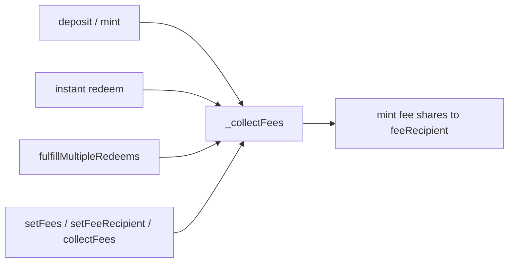

# Vault Economics

This doc explains how UltraVault values itself, prices shares, and charges fees. For how prices are produced and published, see [Oracles](ORACLES.md); for the redeem lifecycle these fees attach to, see [Flows](FLOWS.md).

## Economic primitives

- **Base asset** — the vault's accounting token, returned by `asset()`. All share math is denominated in it.
- **Asset** — any supported token a user can deposit or redeem into, including the base asset. Non-base assets are converted through the rate provider.
- **Shares** — ERC-20 ownership units of the vault itself.
- **Share price** — underlying base-asset value of one share, scaled by `SCALE = 1e18`.

## Share pricing model

Pricing is fully oracle-driven rather than derived from on-chain balances. `_getSharePrice()` reads `oracle().currentSharePrice()` (base-asset units per share, `1e18`-scaled), and every conversion uses that single number:

- `convertToAssets(shares) = shares * sharePrice / 1e18` (rounds down)
- `convertToShares(assets) = assets * 1e18 / sharePrice` (rounds down)
- `totalAssets() = convertToAssets(totalSupply())`

The ERC-4626 internal `_convertToShares`/`_convertToAssets` are overridden to use the same oracle math (honoring the caller's rounding), so the deposit path can't be mispriced by the virtual-offset trick on the first deposit when the oracle isn't 1:1.

Because the price is published from an off-chain valuation, it is meant to be set **conservatively** — assets are marked at a value the vault can defensibly honor, so redemptions don't overdraw the book. Multi-asset legs convert through `convertToUnderlying`/`convertFromUnderlying(asset, amount, Adjustment)`, where the `Adjustment.UP`/`DOWN` direction is chosen to round in the vault's favor.

## Fee model

Fees are configured in a single `Fees` struct (in `Types.sol`); all rates are `1e18`-scaled (`100% = 1e18`). `_setFees` enforces hard caps and reverts `InvalidFees` otherwise:

| Fee | Field | Cap | Charged in | When |
| --- | --- | --- | --- | --- |
| Performance | `performanceFee` | 30% | shares | on collection, above high-water mark |
| Management | `managementFee` | 5% | shares | on collection, time-based |
| Withdrawal | `withdrawalFee` | 1% | output asset | at redeem fulfillment |
| Instant-redeem premium | `instantRedeemPremium` | 0.5% (`MAX_INSTANT_REDEEM_PREMIUM`) | output asset | on instant redeem only |

- **Performance** — high-water-mark based. Zero when `sharePrice <= highwaterMark`; otherwise `performanceFee * (sharePrice - highwaterMark) * totalShares / (1e18 * 1e18)`. The mark only ratchets up, so gains are charged once.
- **Management** — annualized over `ONE_YEAR` (31,536,000 s): `managementFee * totalAssets * timePassed / ONE_YEAR / 1e18`, where `timePassed` runs from `lastUpdateTimestamp`. More TVL and more elapsed time means more accrual.
- **Withdrawal** — taken in asset units at fulfillment, pulled from `fundsHolder` to `feeRecipient` (`WithdrawalFeeCollected`).
- **Instant-redeem premium** — added on top of the withdrawal fee, and only on the instant path.

`accruedFees()` returns `(uint256 managementFee, uint256 performanceFee)` as a preview of what the next collection would crystallize.

### Collection

`_collectFees()` snapshots `{totalAssets, totalShares, sharePrice}`, bumps `highwaterMark` if the price rose, and — when management + performance fees are non-zero — mints the combined amount as shares to `feeRecipient`, refreshes `lastUpdateTimestamp`, and emits `FeesCollected(shares, managementFee, performanceFee, totalAssets, totalShares, sharePrice)`.

Collection runs before any privileged action that changes share supply, keeping accrual consistent. `setupInitialBalances` anchors `highwaterMark` to the live price so bootstrapped value isn't later booked as performance.

## Instant-redeem economics

Instant redeem bypasses the async queue and pays out of a dedicated `instantRedeemExitpoint`, separate from `fundsHolder`. Available liquidity is `getLiquidity(asset) = min(exitpoint balance, exitpoint→vault allowance)`.

`_previewInstantRedeem` computes `grossAssets = convertFromUnderlying(asset, convertToAssets(shares), DOWN)`, an additive `fee = grossAssets * (withdrawalFee + instantRedeemPremium) / 1e18`, and `netAssets = grossAssets - fee`. On `instantRedeem`:

- `netAssets` goes to the receiver and `fee` to `feeRecipient` — **both** pulled from the exitpoint, so liquidity bounds the *gross* payout (`InsufficientLiquidity` if `grossAssets > getLiquidity(asset)`).
- A `minAssets` slippage floor reverts `InstantRedeemSlippageExceeded` when `netAssets < minAssets` (pass `0` to disable).
- Emits both ERC-4626 `Withdraw` and `InstantRedeem(controller, receiver, asset, shares, netAssets, fee)`.

`maxInstantRedeem(asset, controller)` reflects this: it derives shares from available liquidity and caps them at the controller's balance, returning `0` when the controller is ineligible or liquidity is exhausted.
