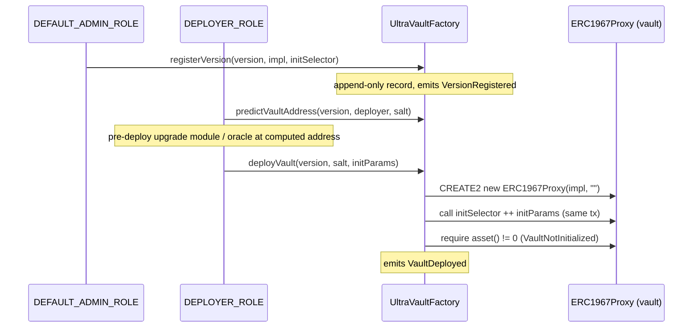

# Vault Factory

`UltraVaultFactory` is the deployment entrypoint for V2 vaults. It maintains a registry of vault implementations keyed by semantic version, and deploys ERC1967 proxies of those implementations at deterministic CREATE2 addresses. The factory is itself a UUPS proxy (`AccessControlUpgradeable`, `UUPSUpgradeable`).

It exists to make vault deployment **predictable and governed**: implementations are vetted and registered once, deployers spin up proxies of an approved version, and a vault's address can be computed before the vault exists.

## Why a version registry

`UltraVault` is an abstract base; the deployable contracts are its concrete variants (`CompliantUltraVault`, `AllowlistUltraVault`). Each is deployed once as a logic contract and registered with the factory under a `Version` (`{ uint8 major; uint8 minor; uint8 patch; string tag; }`). The `tag` is part of identity, so `"1.2.0-rc1"` and `"1.2.0"` resolve to different registry keys.

The registry is **append-only**: a version key maps one-to-one to an implementation, and neither can be reused. Versions are never removed — only disabled and re-enabled. The registry key is `keccak256(abi.encode(major, minor, patch, tag))` (`abi.encode`, not `encodePacked`, for collision-safety against the dynamic `tag`).

Each record (`VersionInfo`) also stores the implementation's `initSelector`, so the factory knows which initializer to call on deploy, and a `disabled` flag that blocks deployment while leaving lookups resolvable.

## Role split

- `DEFAULT_ADMIN_ROLE` — manages the registry (`registerVersion`, `setVersionDisabled`) and authorizes factory self-upgrades (`_authorizeUpgrade`).
- `DEPLOYER_ROLE` — deploys vaults (`deployVault`). Defined in the factory file itself, not in `Roles.sol`.

Registration is a privileged, deliberate act (vetting a new implementation); deployment is a routine operation delegated to deployer accounts. See [Roles & Permissions](PERMISSIONS.md).

## Deterministic deployment

Proxies are deployed with **empty constructor data**, so a vault address depends only on `(factory, deployer, salt, implementation)`. The effective CREATE2 salt binds the caller's salt to the deployer: `keccak256(abi.encode(deployer, salt))`. This prevents one deployer from occupying an address predicted for another.

Because the address is computable in advance via `predictVaultAddress(version, deployer, salt)`, a deployer can pre-deploy contracts that reference the vault — its `TimelockedUpgradeModule`, its oracle and [rate provider](ORACLES.md) — before the vault itself exists, then wire them in at initialization.

## Deploy flow guarantees

`deployVault` resolves the implementation (`UnknownVersion` if absent, `DisabledVersion` if disabled), checks the predicted address is empty (`SaltAlreadyUsed` otherwise — a `(deployer, salt)` pair is consumable once), deploys the proxy, then calls the registered initializer in the same transaction. Initializer reverts bubble up. Finally it requires `IERC4626(vault).asset() != address(0)`. This is a sanity check that the initializer actually ran — an uninitialized proxy reports `address(0)` — not proof that every field was configured correctly; it only asserts the ERC-4626 asset slot is populated. It catches a proxy left wholly uninitialized before `VaultDeployed` is emitted, but verifying full configuration (registry addresses, fees, roles) remains the caller's responsibility.

The `initParams` carry the vault's configuration, including the addresses of pre-deployed dependencies such as the upgrade module and freeze registry, which the vault records in its key-based address registry.

## Relation to vault variants and upgrades

The factory is variant-agnostic: `CompliantUltraVault` and `AllowlistUltraVault` are just different registered implementations selected by `Version`. The factory does not configure compliance or allowlist behavior — that lives in the chosen implementation and its `initParams`.

Vault upgrades are **not** handled by the factory. Each vault delegates its UUPS upgrade authority to an external `TimelockedUpgradeModule`: the vault's `_authorizeUpgrade` requires `msg.sender == upgradeModule()`, and the module gates proposal/execution on the vault's `UPGRADER_ROLE` behind a 7-day timelock. The factory's own `_authorizeUpgrade` is separate and admin-gated. So the factory governs *which implementation a new vault starts from*, while the per-vault upgrade module governs *how an existing vault moves to a new one*.

## Events

`VersionRegistered`, `VersionDisabled`, `VersionEnabled`, and `VaultDeployed(vault, versionKey, implementation, salt, deployer)` provide a full on-chain audit trail of the registry and every deployment.
