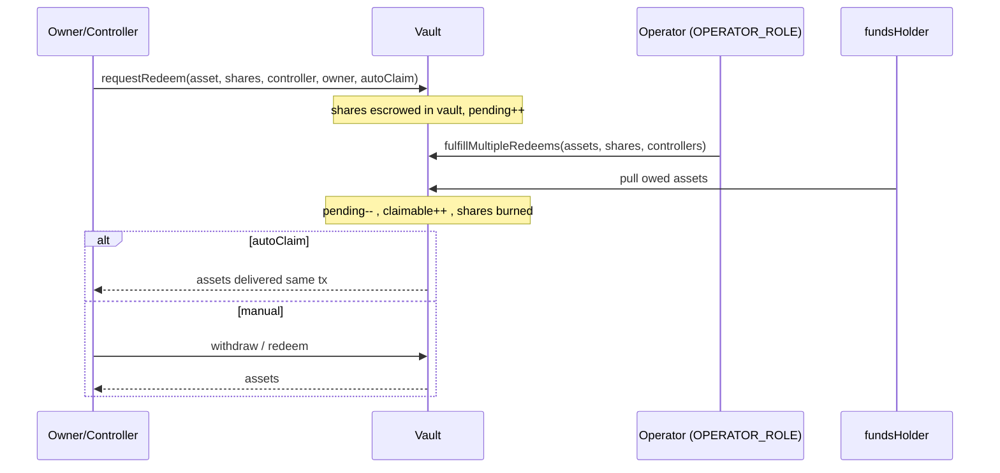

# Vault Lifecycle

An UltraYield V2 vault moves value through three lanes: synchronous **deposit/mint**, an ERC-7540-style **async redeem** queue (request → fulfill → claim), and an opt-in **instant redeem** that exits straight out of an idle-liquidity buffer. Productive assets never sit in the vault itself: deposits flow on to a `fundsHolder` custody address, and the vault pulls assets back only to satisfy fulfilled redeems. See [Vault Economics](ECONOMICS.md) for fees and [Oracles](ORACLES.md) for share pricing.

`UltraVault` is `abstract`; deployments use a concrete variant (`CompliantUltraVault` or `AllowlistUltraVault`) that overrides the gating hooks. Roles are detailed in [Permissions](PERMISSIONS.md).

## Deposit / mint

- `deposit(assets, receiver)` / `mint(shares, receiver)` operate in the base asset; `depositAsset` / `mintWithAsset` accept any supported asset, converted via the rate provider. `depositWithReferral` / `depositAssetWithReferral` additionally emit `Referral`.
- All paths funnel through `_performDeposit`: it transfers tokens from the caller to `_depositRecipient()` — which in `UltraVault` is `fundsHolder()` — mints shares, and emits ERC-4626 `Deposit`. Fees are crystallized first via `_collectFees()`.
- Deposit/mint require `whenNotPaused`; while paused `maxDeposit`/`maxMint` report 0. Empty inputs revert `EmptyDeposit` / `NothingToMint`.

## Async redeem request

A single consolidated entrypoint replaces the V1 overloads:

```solidity
function requestRedeem(address asset, uint256 shares, address controller, address owner, bool autoClaim)
    external returns (uint256 requestId);
```

It moves `owner`'s shares into the vault (escrowed, **not** burned yet) via `_spendAllowance(owner, vault, shares)` then `_transfer` — so `owner` must have approved the vault to spend `shares` of the share token, otherwise the request reverts. It records a pending balance keyed by `(controller, asset)`, persists the `autoClaim` preference (last-writer-wins), and emits `RedeemRequest`. `requestId` is always `REQUEST_ID = 0` — one pending bucket per controller/asset. Access is checked against **both** `owner` and `controller`: `msg.sender` must, for each of them, either be that address or be an approved operator (`setOperator`); otherwise `AccessDenied`. In particular, when `owner != controller`, being only the controller (or its operator) is not enough — the caller must also be the owner or an operator of the owner.



## Cancellation

- `cancelRedeemRequest(asset, controller, receiver)` cancels **all** pending shares for that bucket (no partial cancellation) and returns them to `receiver`, subject to normal transfer gating. Reverts `NoPendingRedeem` if nothing is pending.
- `cancelRedeemRequestByOperator(asset, controller)` (`OPERATOR_ROLE`) returns the escrowed shares to the controller's own wallet using a direct `super._update`, bypassing derived-vault transfer gating so a frozen/restricted controller can still be cleaned up.

## Fulfillment

Only `OPERATOR_ROLE` fulfills, in batch:

```solidity
function fulfillMultipleRedeems(address[] assets, uint256[] shares, address[] controllers)
    external returns (uint256[] memory);
```

`UltraVault` collects fees up front, then per item converts shares to the requested asset at the oracle share price, deducts the withdrawal fee (pulled from `fundsHolder` to `feeRecipient`, emitting `WithdrawalFeeCollected`), and records the net as claimable. The `_beforeFulfillRedeem` hook pulls the owed assets from `fundsHolder` into the vault before settlement, and all consumed shares are `_burn`ed once at the end. Each item emits `RedeemRequestFulfilled`; ragged arrays revert `InputLengthMismatch`.

If the request was made with `autoClaim = true`, fulfillment immediately delivers the assets to the controller in the same transaction (equivalent to an inline `redeem`), so no separate claim step is needed. Query the flag with `getAutoClaim(asset, controller)`.

## Claim / withdraw

After fulfillment (without auto-claim), the controller or its operator pulls assets from the claimable balance:

- `redeem` / `redeemAsset` — target an exact share amount.
- `withdraw` / `withdrawAsset` — target an exact asset amount.

These consume claimable balances and `safeTransfer` assets to the receiver. They are asynchronous and **work while paused**, preserving user exit even during an incident response. `previewWithdraw` / `previewRedeem` revert (unsupported for async); over-claiming reverts `InsufficientClaimableShares` / `InsufficientClaimableAssets`.

## Instant redeem

`instantRedeem(asset, shares, minAssets, receiver, controller)` bypasses the queue entirely, paying out of a dedicated `instantRedeemExitpoint` buffer (distinct from `fundsHolder`). It collects fees, burns the controller's shares, and pulls both `netAssets` (to receiver) and the additive fee (to `feeRecipient`) from the exitpoint, emitting `InstantRedeem` and a standard `Withdraw`.

- Fee is `withdrawalFee + instantRedeemPremium` on top of the gross; the premium is capped at 0.5%.
- `minAssets` is a slippage floor — `InstantRedeemSlippageExceeded` if net falls short (pass `0` to disable).
- The **gross** payout (net + fee) is bounded by `getLiquidity(asset)`, else `InsufficientLiquidity`. Use `maxInstantRedeem` / `previewInstantRedeem` to size a call.

## Removed since V1

When migrating integrations, note these V1 symbols no longer exist:

- Single-asset `fulfillRedeem` → use `fulfillMultipleRedeems`.
- `requestRedeem` overloads and the `…OfAsset` request variants → the consolidated `requestRedeem(asset, shares, controller, owner, autoClaim)`.
- Partial redeem cancellation → `cancelRedeemRequest` now cancels all pending shares.
- The `…ForAsset` / base-asset single-arg redeem getters → `getPendingRedeem(asset, controller)` / `getClaimableRedeem(asset, controller)`.
