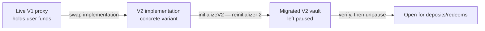

# V1 to V2 Migration

UltraYield V2 is delivered as an **upgrade of the existing V1 proxies**, not only as a fresh deployment. The proxy addresses, share token, and user balances are preserved; only the implementation behind each proxy changes. A one-time migration hook, `initializeV2`, moves live state into the V2 shape after the implementation is swapped.

This document is for integrators upgrading their tooling and for auditors reviewing the migration path. For the rebuilt pricing stack see [Oracles](ORACLES.md); for the fee model see [Economics](ECONOMICS.md); for the redeem lifecycle see [Flows](FLOWS.md).

## Upgrade model

`UltraVault` is now an `abstract` base, so the implementation behind each proxy is a concrete variant — `CompliantUltraVault` or `AllowlistUltraVault`.

## What `initializeV2` does

`initializeV2(address instantRedeemExitpoint, address upgradeModule, address freezeRegistry)` is a `reinitializer(2)` hook run once on a live proxy that already holds user funds:

- **Migratability guard.** Reverts `NotMigratable()` unless the deprecated V1 `_fundsHolder` slot is non-zero. A populated slot is the proof that the proxy carries genuine V1 state; an empty slot means there is nothing to migrate.
- **Address registry seeding.** Live V1 addresses are copied into V2's key-based registry: the rate provider (`RATE_PROVIDER_KEY`), funds holder (`FUNDS_HOLDER_KEY`), and oracle (`ORACLE_KEY`). The two V2-only keys are initialized from the call arguments — `INSTANT_REDEEM_EXITPOINT_KEY` and `UPGRADE_MODULE_KEY` — and `FREEZE_REGISTRY_KEY` is set from `freezeRegistry` (`address(0)` keeps freezing local-only). Only the *live* V1 addresses are copied; any pending V1 address-update proposal (`proposedFundsHolder` / `proposedOracle`) is intentionally **not** migrated — a queued rotation is dropped, so resolve or record it before migrating (see the checklist).
- **High-water-mark rescale.** V2 accounting lives in a single 1e18 share-price space. The stored high-water mark is rescaled out of V1's `10**decimals()` share-value units with `highwaterMark *= 10 ** (18 - decimals())` so it compares correctly against the 1e18-scaled oracle price.
- **Leaves the vault paused.** Migration ends with the vault paused so operators can verify migrated addresses and price before reopening.

The 1e18 move is also reflected in the renamed in-memory accounting struct `Totals`: V1's `totalSupply`/`shareValue` fields are now `totalShares`/`sharePrice`. The deprecated V1 slots (`_fundsHolder`, `_oracle`, `_proposedFundsHolder`, `_proposedOracle`, `_rateProvider`) remain in the storage layout for compatibility but are superseded by the registry.

## Legacy V1 code

The original V1 contracts are preserved verbatim under `src/legacy/v1/` (e.g. `UltraVaultV1.sol`, `UltraVaultOracleV1.sol`, `IPriceSourceV1.sol`). They are kept for reference and for the V1 compatibility shim (`UltraVaultOracle.getQuote`); they are not part of the live V2 deployment.

## Breaking changes for integrators

- **Oracle API rebuilt.** `setPrice`, `scheduleLinearPriceUpdate`, and `getCurrentPrice` are gone. Prices are pushed through `VaultPriceManager.instantPriceUpdate` / `linearPriceUpdate`, which call `UltraVaultOracle.applyPriceUpdate`; read the live price with `currentSharePrice()`. See [Oracles](ORACLES.md).
- **Consolidated redeem request.** All V1 `requestRedeem` overloads and `…OfAsset` variants collapse into `requestRedeem(address asset, uint256 shares, address controller, address owner, bool autoClaim)`.
- **No single-asset fulfillment.** V1 `fulfillRedeem` is removed; operators settle with `fulfillMultipleRedeems(address[] assets, uint256[] shares, address[] controllers)`.
- **`accruedFees()` return shape.** `accruedManagementFees()` / `accruedPerformanceFees()` are replaced by `accruedFees()` returning `(uint256 managementFee, uint256 performanceFee)`.
- **`Types.sol` import paths.** `Adjustment`, `Fees`, `Price`, `PendingRedeem`, and `ClaimableRedeem` moved into `src/interfaces/Types.sol`; old per-interface import paths no longer resolve. `Fees` also gained `instantRedeemPremium`.
- **Removed contracts.** `UltraFeeder` and the `OracleAdmin` contract (and `ORACLE_ADMIN_ROLE`) are gone; oracle operation is absorbed into the `VaultPriceManager` admin model (`isAdmin` / `onlyAdminOrOwner`).
- **Address management.** Per-field funds-holder / oracle / rate-provider propose-accept methods are replaced by the generic key-based `proposeAddressUpdate` / `acceptAddressUpdate`.

## Step-by-step upgrade

1. **Deploy V2 supporting contracts.** The concrete vault implementation (`CompliantUltraVault` or `AllowlistUltraVault`), the external `upgradeModule` (timelocked upgrade authority), the V2 oracle/`VaultPriceManager`, and — if used — the `instantRedeemExitpoint` and `freezeRegistry`.
2. **Drain queued V1 governance first.** `initializeV2` carries over only the live V1 addresses; any outstanding V1 address-update proposal (`proposedFundsHolder` / `proposedOracle`) is dropped, not migrated — a silent state loss. Before swapping, either accept or cancel every pending V1 proposal, or record it and replay it after migration via `proposeAddressUpdate` / `acceptAddressUpdate`.
3. **Swap the implementation.** Point each live V1 proxy at the V2 implementation using the existing V1 upgrade authority.
4. **Run the migration.** Call `initializeV2(instantRedeemExitpoint, upgradeModule, freezeRegistry)` once per proxy. It seeds the registry, rescales the high-water mark, and leaves the vault paused.
5. **Wire pricing and upgrades.** Hand the oracle to its `VaultPriceManager` (`claimOracleOwnership`), configure CCIP destinations for cross-chain vaults, and confirm UUPS authorization now routes through `upgradeModule()`. Switch to a new oracle, if desired, via `proposeAddressUpdate(ORACLE_KEY, …)`.
6. **Verify, then reopen.** Check the migrated registry addresses and the live `currentSharePrice()`, then unpause with `UNPAUSER_ROLE`.
