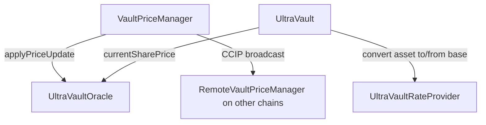

# Oracle and Rate Provider System

UltraYield V2 prices a vault through two independent layers. Keeping them separate lets share-price reporting and per-asset conversion evolve on their own, and lets the share price stay a deterministic function of time while asset conversion stays a function of market rates.

- **Vault valuation layer** — what one share is worth in the vault's base asset. Owned by `UltraVaultOracle` and orchestrated by `VaultPriceManager`.
- **Asset conversion layer** — how each supported deposit/redeem asset converts to and from that base asset. Owned by `UltraVaultRateProvider` and a set of pluggable rate primitives. See [Rate Providers](RATE_PROVIDERS.md).

## Vault valuation layer

### `UltraVaultOracle`

`UltraVaultOracle` is an append-only, single-vault share-price oracle (`Ownable2Step`). It records each update verbatim into a sorted `PriceUpdate[]` history and reports the live price as a **pure function of `block.timestamp`**. Identical bytecode evaluating the same recorded update at the same timestamp therefore yields the same price on any chain — so chains price off one shared update log rather than independent feeds. This is *synchronized* pricing, not instantaneous lockstep across chains: CCIP delivery latency and per-chain `block.timestamp` skew mean two chains can read slightly different live prices at the same wall-clock moment, converging as updates propagate. That determinism is what makes cross-chain valuation trustless.

The constructor binds the oracle to one ERC-4626 `vault` and its `asset`, and requires the two to share decimals (`DecimalsMismatch`). It then seeds an instant initial price, so the history is never empty.

Writes go through one entrypoint, `applyPriceUpdate(startPrice, targetPrice, vestingDuration, startTimestamp)` (`onlyOwner`). Each update is either:

- **instant** (`vestingDuration == 0`) — the price jumps to `targetPrice` at `startTimestamp`; or
- **vesting** — the price moves linearly from `startPrice` to `targetPrice` over `vestingDuration`, bounded to `[MIN_VESTING_DURATION, MAX_VESTING_DURATION]` (24h–7d).

Two invariants guard the curve:

- **Up-only vesting.** A vesting segment must have `targetPrice > startPrice` (`DrawdownVestingNotAllowed`). Drawdowns must be instant — downside is reflected immediately, never smoothed.
- **Monotonic timestamps.** Each `startTimestamp` must be `>=` the previous one (`NonMonotonicTimestamp`), keeping the history sorted for read-side searches.

Prices fit `uint88` and timestamps fit `uint40`, enforced on every write (`Overflow`). Every recorded update (including the seed) emits `PriceUpdated(startPrice, targetPrice, vestingDuration, startTimestamp)`.

#### Reads

- `currentSharePrice()` — the hot path called on every vault op. Scans backward from the tail to the update governing `block.timestamp` and interpolates. Reverts `NoPriceData` only before the seed timestamp.
- `historicalSharePrice(timestamp)` / `sharePriceAt(timestamp)` — binary search over a checkpoint index (`Checkpoints.Trace208`) for off-chain or occasional lookups and for projecting the curve to a future activation instant. Reverts `NoPriceData` for times before the first update.
- `getQuote(inAmount, base, quote)` — a V1 compatibility shim. It accepts only the bound `(vault, asset)` pair (`VaultMismatch` / `AssetMismatch`) and returns `inAmount * currentSharePrice() / 1e18`; equal decimals collapse the old V1 formula to this.

### `VaultPriceManager`

`VaultPriceManager` is the main-chain orchestrator for one oracle/vault pair, built on `BaseVaultPriceManager`. In the intended topology it owns the oracle (via `claimOracleOwnership()`), so all price writes flow through it. Operators push prices with `instantPriceUpdate` or `linearPriceUpdate` (`onlyAdminOrOwner`); both activate at `block.timestamp + delay`, apply the update to the local oracle, and then broadcast it over Chainlink CCIP so every chain stays in lockstep.

A shared safety check (`wouldTriggerPause`) compares the new price against asymmetric `jumpUp` / `jumpDown` limits (each `<= MAX_JUMP_LIMIT`, 100%). A breach either reverts (`failOnPause = true`) or pauses the vault, after which the update still writes. Privileged config — `updateLimits`, `setDelay` (bounded `[MIN_DELAY, MAX_DELAY]`), destination-registry membership (`addDestination` / `removeDestination` / `updateDestinationConfig`), LINK management (`withdrawLink`), and the admin set (`addAdmin` / `removeAdmin`) — is `onlyOwner`. One destination control is shared rather than owner-only: `setDestinationActive`, the escape hatch that flips a destination's `active` flag, is `onlyAdminOrOwner`, so an admin can activate or deactivate a destination — gating whether broadcasts reach it — without otherwise touching its registry entry.

The cross-chain message format, destination registry, nonce model, and the receiving `RemoteVaultPriceManager` are covered in [Cross-Chain Price Sync](CROSSCHAIN.md).

## Asset conversion layer

`UltraVaultRateProvider` is an owner-curated registry mapping each supported asset to how it is valued against the vault's single `baseAsset`: pegged (decimal rescale only) or delegated to an external `IRateProvider` (Chainlink feeds, ERC-4626 wrappers, or composed chains), with a small conservative `Adjustment` haircut. The vault calls its `convertToUnderlying` / `convertFromUnderlying` entrypoints on every multi-asset deposit and redeem.

This layer, the pricing primitives, and end-to-end composition examples are documented in [Rate Providers](RATE_PROVIDERS.md).

## Roles

- **Oracle owner** — the only caller of `applyPriceUpdate`. Normally the `VaultPriceManager`.
- **Manager owner** — limits, delay, destination-registry membership, LINK, admin set, and oracle-ownership claiming.
- **Manager admin** (`isAdmin`) — operational price pushes, plus flipping a destination's `active` flag via `setDestinationActive` (activate/deactivate, gating whether broadcasts reach it); cannot change limits, delay, destination-registry membership, or LINK.

There is no separate `OracleAdmin` role or contract in V2; the admin model lives entirely in `BaseVaultPriceManager`.
