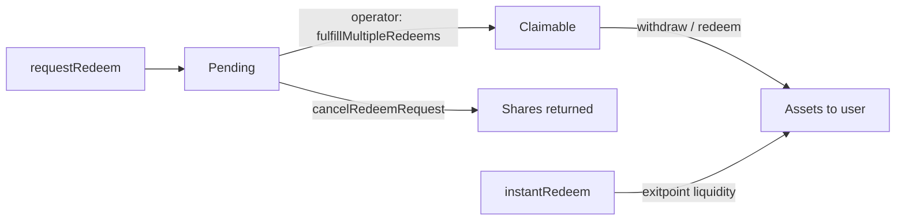

# UltraYield Vault Overview

UltraYield vaults give users access to yield strategies that span DeFi and CeFi. Users deposit a supported asset and receive vault shares; the strategy capital itself is run operationally by curators rather than by on-chain strategy code. The vault tracks each user's claim as ERC-20 shares, and share value moves with strategy performance through an on-chain oracle.

This is the entry-point document. It explains the custody model, the pricing model, the two vault variants, and the two exit paths, and links out to the detailed specs.

## What the vaults do

- Accept deposits in the base asset (or any configured supported asset) and mint shares.
- Hold no productive capital in the vault contract itself — assets are forwarded to a custody address controlled by the curator and infrastructure parties.
- Price shares off a single, deterministic oracle so valuation is independent of where the capital currently sits.
- Settle redemptions asynchronously (curator prepares liquidity), with an optional instant path backed by a dedicated liquidity buffer.

The vaults follow `ERC-4626` (tokenized vault), `ERC-7540` (async redeem with synchronous deposits), `ERC-7575` (multi-asset), and `ERC-165`. `supportsInterface` advertises `IERC7540Redeem`, `IERC7575`, and `IERC7540Operator`.

## Custody and strategy-execution model

On deposit, assets are transferred straight to `fundsHolder` — the curator's custody address — never escrowed idle in the vault. Curators typically operate `fundsHolder` as an MPC wallet with strict whitelisting that constrains which protocols, contracts, and recipient addresses are reachable. This balances operational security (no arbitrary withdrawals to non-whitelisted addresses) against the flexibility to add or rotate strategy venues without on-chain verification of every low-level call. Capital is not pinned to the initial wallet and may be re-allocated across wallets or venues as the strategy requires.

A second, separate custody address, `instantRedeemExitpoint`, holds idle liquidity that backs instant redemptions only; it is intentionally distinct from `fundsHolder` so the productive book and the instant-exit buffer are isolated. Both addresses, along with the oracle, rate provider, freeze registry, and upgrade module, are resolved through a key-based address registry (`proposeAddressUpdate` / `acceptAddressUpdate`) with per-key timelocks; accepting an update pauses the vault so operators can verify the new wiring before reopening.

## Pricing and oracle model

Valuation is produced independently of custody execution. NAV is computed off-chain by the curator and published on-chain to `UltraVaultOracle`, which reports one share price scaled to `1e18` as a deterministic function of `block.timestamp`. `totalAssets()` is purely oracle-derived (`convertToAssets(totalSupply())`), not the vault's token balance, so it is unaffected by capital movement between venues.

The model is intentionally conservative: prices can vest upward over a bounded window but drawdowns must apply instantly, and the price-manager enforces asymmetric jump limits that can pause the vault on an abnormal move. Conservative pricing keeps fulfilled redemptions fully payable under normal operations. See [Oracles](ORACLES.md) for the curve mechanics and cross-chain broadcast.

## Vault variants

`UltraVault` is an `abstract` base holding all shared mechanics (oracle pricing, fees, custody routing, async and instant redeem). It is not deployed directly — each deployment is one of two concrete variants that add access gating through shared `virtual` hooks:

- `CompliantUltraVault` — a deny-list model. A `COMPLIANCE_ROLE` holder can `freeze` addresses (locally and/or via a shared `SharedFreezeRegistry`) and `forceBurn` shares from any wallet. Freeze and `forceBurn` are independent operations — `forceBurn` burns a target's share balance regardless of whether that wallet is frozen. Frozen addresses cannot receive shares, deposit, claim, or instant-redeem.
- `AllowlistUltraVault` — an allow-list model, enforced by default. Shares can only ever land on `ALLOWLIST_ROLE`-approved wallets; self-exit stays open even for a non-allowlisted controller. The owner can lift enforcement with `setAllowlistEnabled`.

See [Permissions](PERMISSIONS.md) for the full role and gating matrix.

## Redemption at a glance

Async redemption exists because strategy capital is not sitting idle for immediate withdrawal. An instant path is offered on top, bounded by the exitpoint buffer.

- **Async**: `requestRedeem(asset, shares, controller, owner, autoClaim)` escrows shares in the vault and opens a pending claim per `(controller, asset)`. An `OPERATOR_ROLE` holder calls `fulfillMultipleRedeems` to move it to claimable; the user then claims with `withdraw` / `redeem`. The exit amount is fixed at fulfillment — the position stays exposed to yield and drawdown until then, and not after. Claims work even while the vault is paused.
- **autoClaim**: if set on the request, fulfillment delivers assets to the controller in the same transaction, with no separate claim step.
- **Cancellation**: `cancelRedeemRequest` returns all pending shares before fulfillment (no partial cancel).
- **Instant**: `instantRedeem(asset, shares, minAssets, receiver, controller)` burns shares and pays out of `instantRedeemExitpoint`, subject to available liquidity, a slippage guard (`minAssets`), and an additive instant-redeem premium on top of the withdrawal fee.

Fulfillment cadence depends on the vault's spec; under normal operations it is expected not to exceed 72 hours.

## Detailed docs

- [Architecture](ARCHITECTURE.md) — contract inheritance, storage, and module split.
- [Flows](FLOWS.md) — deposit, request, fulfillment, claim, and address-update lifecycles.
- [Oracles](ORACLES.md) — deterministic price curve and the cross-chain price manager.
- [Economics](ECONOMICS.md) — management, performance, withdrawal, and instant-redeem fees.
- [Permissions](PERMISSIONS.md) — roles, gating, and the compliance/allowlist variants.
