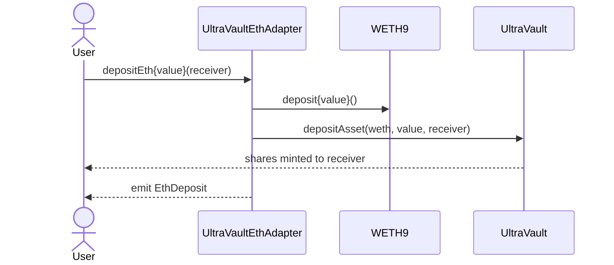

# Periphery Contracts

Periphery contracts sit outside the core vault accounting and are not required for the vault to function. They exist to make integration easier: one wraps native-ETH UX around a WETH vault, the other aggregates read-only state for frontends. Both are new in V2 and both depend only on the public `IUltraVault` surface — they hold no privileged accounting power over the vault.

## UltraVaultEthAdapter

`UltraVaultEthAdapter` lets users deposit and redeem **native ETH** against an `UltraVault` whose underlying asset is **WETH**. The vault itself only understands ERC-20 WETH; the adapter is the thin wrap/unwrap layer that bridges native ETH to it, so wallets and dapps can offer a one-click ETH flow without the user manually wrapping.

It is upgradeable: `Ownable2StepUpgradeable`, `PausableUpgradeable`, and `UUPSUpgradeable`, deployed behind a proxy.

- `vault` and `weth` are `immutable`, fixed in the implementation `constructor`. The constructor rejects zero addresses (`ZeroAddress`) and enforces `weth == vault.asset()` (`AssetMismatch`), so an adapter can never be paired with a vault whose asset is not its WETH.
- `initialize(owner)` sets the `owner` (2-step transfer) and grants the vault a **one-time unlimited WETH approval**, so per-deposit approvals are never needed.
- The `owner` is the only role: it can `pause()` / `unpause()` and is the sole authority for `_authorizeUpgrade`.

### Deposit flow

`depositEth()` (and the `depositEth(receiver)` overload) wraps `msg.value` into WETH and calls `vault.depositAsset(weth, msg.value, receiver)`. Shares mint **directly to `receiver`** — the adapter never holds them. `previewDepositEth(amount)` is a pure passthrough to the vault's preview and has no pause guard.

For attribution, `depositEthWithReferral(referralId)` (and its `receiver` overload) runs the same deposit, then emits a separate `Referral(referralId, user, shares)` event alongside the standard `EthDeposit`.

### Redeem flow

`redeemEth(shares[, receiver])` settles an **already-fulfilled async redeem request** back into native ETH. It calls `vault.redeemAsset(weth, shares, address(this), controller)` with `controller = msg.sender`, so WETH lands on the adapter; the adapter then `weth.withdraw(...)` and forwards ETH to `receiver` via a low-level call, reverting `EthTransferFailed` on failure and emitting `EthWithdraw`. The caller is always the redeem controller; `receiver` only receives the ETH. See the vault's async redeem lifecycle in [Flows](FLOWS.md).

### ETH intake guard

`receive()` accepts ETH **only from the WETH contract** (during `withdraw`); any other direct send reverts `InvalidDeposit`. This prevents stray ETH from being trapped or mistaken for a deposit. Errors are `ZeroEthValue`, `ZeroAddress`, `AssetMismatch`, `InvalidDeposit`, `EthTransferFailed`; events are `EthDeposit`, `EthWithdraw`, `Referral`.

## UltraFrontendHelper

`UltraFrontendHelper` is a stateless, read-only aggregator for a single vault. It bundles several vault calls into one round-trip so a frontend can render vault state, quote a deposit/redeem, and enumerate pending withdrawals without orchestrating many low-level calls. It is non-upgradeable, not pausable, and has no roles; `vault` is `immutable`, validated in the constructor (`"ZERO_ADDRESS"`, then `vault.fundsHolder() != address(0)` → `"INVALID_VAULT"`).

- `getVaultState()` returns a `VaultState { totalAssets, totalShares, sharePrice }`, where `sharePrice` is assets per one whole share (`convertToAssets(10 ** decimals)`).
- `previewDeposit(asset, amount)` converts the input asset to base units (`Adjustment.DOWN`) then to shares. It does **not** subtract a deposit fee.
- `previewRedeem(asset, shares)` returns the net assets after the **async withdrawal fee** (`calculateWithdrawalFee`). It reflects only the queue path — not the instant-redeem premium. For asset conversion and rounding semantics see [Oracle and Rate Provider System](ORACLES.md).
- `collectPendingRedeems(assets, users)` validates each asset via `rateProvider().isSupported(...)` (`"UNSUPPORTED_ASSET"`) and returns one `Redeem { user, asset, shares, requestTime }` per non-empty `getPendingRedeem(asset, user)`, or an empty array when none.

Note the helper uses string reverts, while the adapter uses custom errors.
