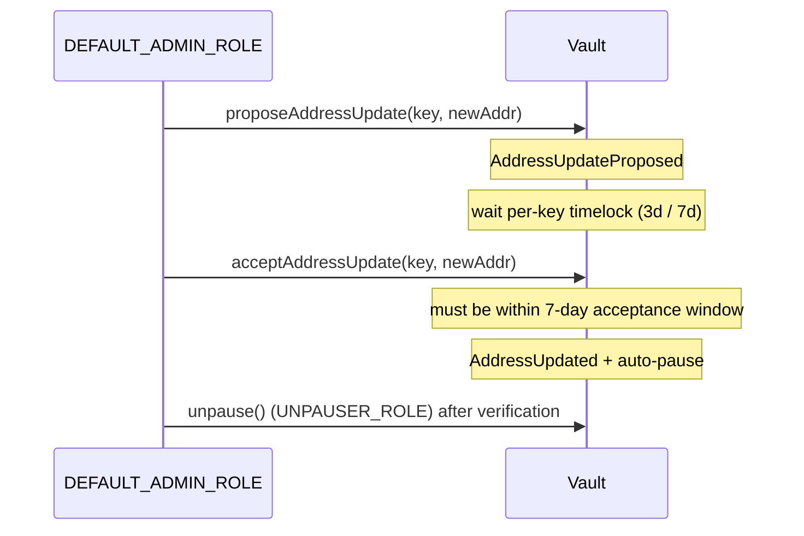

# Roles, Permissions, and Operations

UltraYield V2 governs privileged actions with OpenZeppelin `AccessControl`. Every role is a `bytes32` constant; `DEFAULT_ADMIN_ROLE` is the root administrator that grants and revokes the others. The vault is no longer "owner"-based in the `Ownable` sense — the `onlyOwner` modifier in `BaseControlledAsyncRedeem` is just a check for `hasRole(DEFAULT_ADMIN_ROLE, msg.sender)` and reverts `NotOwner()`.

This split-role model lets a deployment separate day-to-day operations (fulfilling redeems, pausing) from custody-grade governance (rotating addresses, upgrading, compliance) without a single all-powerful key.

## Roles

The seven core roles live in `src/utils/Roles.sol`; `DEPLOYER_ROLE` is defined separately in `src/factory/UltraVaultFactory.sol` because it only gates factory deployment.

| Role | Identifier | Gates |
| --- | --- | --- |
| `DEFAULT_ADMIN_ROLE` | `0x00` | Root admin: grants/revokes roles; `onlyOwner` actions (fees, `proposeAddressUpdate`/`acceptAddressUpdate`); factory version registry + factory self-upgrade |
| `OPERATOR_ROLE` | `keccak256("OPERATOR_ROLE")` | `fulfillMultipleRedeems` — the redeem-fulfillment operator |
| `PAUSER_ROLE` | `keccak256("PAUSER_ROLE")` | `pause()` |
| `UNPAUSER_ROLE` | `keccak256("UNPAUSER_ROLE")` | `unpause()` |
| `UPGRADER_ROLE` | `keccak256("UPGRADER_ROLE")` | propose/cancel/execute on the `TimelockedUpgradeModule` |
| `COMPLIANCE_ROLE` | `keccak256("COMPLIANCE_ROLE")` | freeze/unfreeze on `SharedFreezeRegistry`; freeze/unfreeze + `forceBurn` on `CompliantUltraVault` (`forceBurn` is vault-only) |
| `ALLOWLIST_ROLE` | `keccak256("ALLOWLIST_ROLE")` | add/remove on `AllowlistUltraVault` |
| `DEPLOYER_ROLE` | `keccak256("DEPLOYER_ROLE")` | `deployVault` on `UltraVaultFactory` |

> `ORACLE_ADMIN_ROLE` was **removed** in V2; oracle administration is absorbed into the price-manager admin model. See [Oracle & Pricing](ORACLES.md).

## Pause / unpause split

V2 separates pausing from unpausing. `pause()` requires `PAUSER_ROLE`; `unpause()` requires `UNPAUSER_ROLE`. This lets an automated guardian hold only the ability to halt the vault while resuming stays behind a more trusted key. Note that `acceptAddressUpdate` auto-pauses the vault if it is not already paused, so a critical address rotation always ends paused for operators to verify the new setup before an explicit `unpause()`.

## User-level delegated access

Separate from the role table, share controllers can delegate their own request/cancel/claim authority to another address:

- `setOperator(operator, approved)` records the approval and emits `OperatorSet(controller, operator, approved)`. A controller cannot set itself (`CannotSetSelfAsOperator`).
- The `checkAccess(controller)` modifier guards the async-redeem flows: it passes when `msg.sender == controller` **or** the controller has approved `msg.sender` as an operator, otherwise it reverts `AccessDenied()`.

This is per-user delegation (ERC-7540 style), not an `AccessControl` role — it never grants protocol-wide privileges.

## Key-based address governance

V2 replaces V1's per-field propose/accept methods (funds holder, oracle, rate provider) with one generic, timelocked registry: `AddressUpdatable` (`src/utils/AddressUpdates.sol`) keyed by the `bytes32` constants in `src/utils/AddressKeys.sol` (`FUNDS_HOLDER_KEY`, `ORACLE_KEY`, `RATE_PROVIDER_KEY`, `UPGRADE_MODULE_KEY`, `INSTANT_REDEEM_EXITPOINT_KEY`, `FREEZE_REGISTRY_KEY`).

Both entry points are `onlyOwner` (i.e. `DEFAULT_ADMIN_ROLE`) and live on the vault (`BaseControlledAsyncRedeem`):

- `proposeAddressUpdate(key, newAddress)` — records the proposal and emits `AddressUpdateProposed(key, newAddress)`. Zero addresses are rejected (`ZeroAddressInput`).
- `acceptAddressUpdate(key, newAddress)` — after the per-key timelock elapses and within the `ADDRESS_ACCEPTANCE_WINDOW` (7 days), writes the new address, emits `AddressUpdated(key, oldAddress, newAddress)`, and pauses the vault.

The timelock is resolved per key by `_timelockForKey`: `UPGRADE_MODULE_KEY` is 7 days; every other key (`RATE_PROVIDER_KEY`, `FUNDS_HOLDER_KEY`, `ORACLE_KEY`, `INSTANT_REDEEM_EXITPOINT_KEY`, `FREEZE_REGISTRY_KEY`) is 3 days. An unsupported key reverts `UnknownAddressKey(key)`.

The `upgradeModule` address itself is stored under `UPGRADE_MODULE_KEY` and rotates through this same flow. Upgrade *execution* is a distinct mechanism: the vault delegates UUPS authorization to the external `TimelockedUpgradeModule`, whose own propose/execute is gated by `UPGRADER_ROLE` read from the vault. See [Upgrades](UPGRADES.md).

## Related documents

- [Compliance & Allowlist](COMPLIANCE.md) — `COMPLIANCE_ROLE`, `ALLOWLIST_ROLE`, and the shared freeze registry.
- [Upgrades](UPGRADES.md) — the timelocked upgrade module and `UPGRADER_ROLE`.
