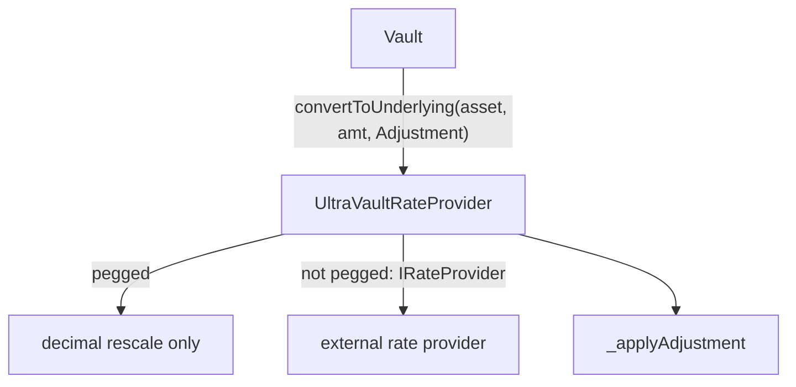
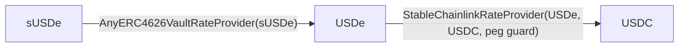

# Rate Providers

The rate-provider stack answers one question for an UltraVault: *how much is an amount of some supported asset worth in the vault's base asset?* It splits that into two layers so valuation policy and raw pricing stay independent.

- **Registry layer** — `UltraVaultRateProvider`, one per vault. An owner-curated map from each supported asset to how it is valued, plus the `Adjustment`-aware entrypoints the vault calls.
- **Conversion layer** — standalone pricing primitives, each implementing the minimal `IRateProvider` interface. The registry delegates to these for any asset that is not pegged 1:1 to the base asset.

The seam between the layers is `IRateProvider`: when an asset is not pegged, the registry calls `IRateProvider(rateProvider).convertToUnderlying(...)` / `.convertFromUnderlying(...)`.

## `IRateProvider`

The two-function interface every conversion primitive implements:

- `convertToUnderlying(address asset, uint256 assets)` — convert an amount of `asset` into the provider's underlying units.
- `convertFromUnderlying(address asset, uint256 baseAssets)` — the inverse.

The interface NatSpec mentions 18 decimals, but concrete providers return amounts in their own underlying token's native decimals; treat outputs as "in the provider's underlying-asset units."

## `UltraVaultRateProvider` — the per-vault registry

A non-upgradeable `Ownable2Step` contract. Its constructor `(address _owner, address _baseAsset)` records `baseAsset` and `baseDecimals` (read from `IERC20Metadata`), then self-registers the base asset as pegged with no provider. The base asset is therefore always supported, always pegged 1:1, and can never be removed or updated (`CannotUpdateBaseAsset`).

Each asset is stored in a packed `AssetSlot { decimals, adjustmentRate, rateProvider, __padding }`. A slot with `rateProvider == address(0)` is **pegged** (value 1:1, only decimals differ); a non-zero `rateProvider` points at an `IRateProvider`. Support is keyed on non-zero `decimals`, which is why decimals must land in `[MIN_DECIMALS, MAX_DECIMALS]` = `[6, 18]`.

**Reads.** `getAssetInfo(asset)` returns `(isPegged, decimals, rateProvider, adjustmentRate)`; `getSupportedAssets()` lists every registered asset; `isSupported(asset)`, `baseAsset()`, and `baseDecimals()` round out the view surface.

**Owner writes** (all `onlyOwner`):

- `addAsset(asset, isPegged, rateProvider, adjustmentRate)` — validates the asset is new (`AssetAlreadySupported`), that peg and provider agree (pegged ⇒ zero provider, else non-zero, `InvalidRateProvider`), that decimals fit `[6, 18]` (`InvalidDecimals`), and `adjustmentRate <= MAX_ADJUSTMENT_RATE` (`AdjustmentRateTooHigh`). Emits `AssetAdded`.
- `updateRateProvider(asset, isPegged, newRateProvider)` — re-points an asset, also flipping it between pegged and externally-priced under the same consistency rule. Emits `RateProviderUpdated`. Decimals are immutable once set.
- `updateAdjustmentRate(asset, newAdjustmentRate)` — capped at `MAX_ADJUSTMENT_RATE`. Emits `AdjustmentRateUpdated`.
- `removeAsset(asset)` — swap-pops the asset, emits `AssetRemoved`.

### Conversions and the `Adjustment` haircut

`convertToUnderlying` / `convertFromUnderlying` come in an `Adjustment`-aware three-arg form and a two-arg form (no adjustment) kept for a not-yet-upgraded V1 vault. For pegged assets, conversion is a pure decimal rescale via `_convertDecimals` — no price is read. Otherwise the call is forwarded to the external provider.

The result then passes through `_applyAdjustment`. `Adjustment` is `{ DOWN, UP }` (`SCALE = 1e18` = 100%, `MAX_ADJUSTMENT_RATE = 1e16` = 1%):

- `DOWN` → `amount * (SCALE - adjustmentRate) / SCALE`, rounded down.
- `UP` → `amount * SCALE / (SCALE - adjustmentRate)`, rounded up — the exact inverse of `DOWN`.

A zero `adjustmentRate` is a passthrough. The haircut is a conservative buffer (max 1%) applied to provider output so the vault always values an asset slightly in its own favor.

## The four building blocks

Each is a single-responsibility `IRateProvider` with no notion of the vault or adjustments. Pick by what you are pricing:

- **`AnyERC4626VaultRateProvider`** — wraps any ERC-4626 vault, converting between its shares and **its own underlying** via `convertToAssets` / `convertToShares` (gated on `InvalidAsset`). Because its output is the wrapped vault's underlying, not the UltraVault base asset, do **not** register it directly unless that underlying equals the base asset — otherwise compose it.
- **`ChainlinkRateProvider`** — converts an asset against `underlyingAsset` using two Chainlink USD feeds. The constructor requires non-zero addresses and staleness, decimals in `[6, 18]`, and matching feed decimals (`FeedDecimalsMismatch`). Every read validates the answer (`InvalidFeedAnswer`, `StaleFeed`, `IncompleteRound`). A virtual `_validateRate` hook is a no-op here.
- **`StableChainlinkRateProvider`** — a `ChainlinkRateProvider` for 1:1 pairs that overrides `_validateRate` to reject prices deviating from parity by more than `maxDeviationBps`, hard-capped at `MAX_DEVIATION_BPS = 300` (3%) and owner-tunable via `setMaxDeviationBps` (`RateDeviationTooHigh`, `MaxDeviationBpsUpdated`). Use it whenever the pair is supposed to hold a peg.
- **`ComposableRateProvider`** — chains two providers through one `intermediateAsset`, presenting the pair as a single `IRateProvider`. It is a pure router: no decimal math, each leg handles its own units. Since it is itself an `IRateProvider`, it nests for deeper chains.

## Worked composition: sUSDe → USDe → USDC

To value sUSDe in a USDC-based vault, no single primitive spans the path. Compose two:

- `assetProvider`: `AnyERC4626VaultRateProvider(sUSDe)` prices sUSDe shares in USDe.
- `baseProvider`: `StableChainlinkRateProvider(USDe, USDC, ...)` converts USDe to USDC with a peg guard.
- Wrap both in `ComposableRateProvider(intermediateAsset = USDe, assetProvider, baseProvider)`, then `addAsset(sUSDe, isPegged = false, rateProvider = composite, adjustmentRate)`.

This is exactly the case the `AnyERC4626VaultRateProvider` NatSpec warns must be composed rather than registered directly.

---

See also: [Oracle and Rate Provider System](ORACLES.md), [Architecture](ARCHITECTURE.md), [Permissions](PERMISSIONS.md).
