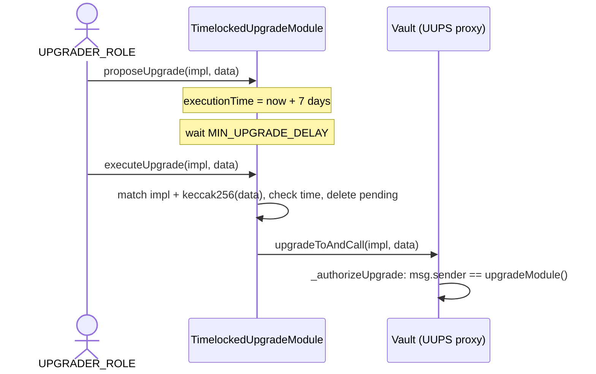
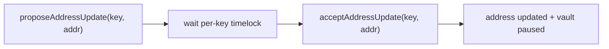

# Upgrades and Address Management

V2 moves two privileged operations — replacing the implementation behind a vault proxy, and re-pointing a vault at a new dependency (oracle, funds holder, etc.) — behind explicit, timelocked, propose-then-confirm flows. Both are designed so that a single compromised key cannot make an instantaneous, irreversible change: every change is announced on-chain and only takes effect after a fixed delay.

## Upgrade model

Vaults are UUPS proxies, but they no longer carry their own timelock logic (V1's in-tree `TimelockedUUPSUpgradeable` is gone). Instead each vault delegates its upgrade authority to an external `TimelockedUpgradeModule`:

- The vault's `_authorizeUpgrade` does only one check — `require(msg.sender == upgradeModule(), AccessDenied())`. The vault trusts whichever module address is registered under `UPGRADE_MODULE_KEY` (see below).
- The module is bound to exactly one vault for its lifetime (`address public immutable vault`, rejecting zero via `ZeroVaultAddress()`). It holds no roles of its own; its `onlyUpgrader` modifier reads `UPGRADER_ROLE` straight from the vault's `AccessControl` table.
- The module enforces a `MIN_UPGRADE_DELAY` of 7 days and tracks a single `pendingUpgrade` at a time, storing only `keccak256(data)` rather than the calldata itself.

`executeUpgrade` re-validates the exact `(implementation, data)` pair against the proposal (`UpgradeImplementationMismatch`, `UpgradeDataMismatch`), requires the delay to have elapsed (`UpgradeNotReady`), and clears the pending slot *before* the external `upgradeToAndCall`. `cancelUpgrade` drops a pending proposal at any time, and `isUpgradeReady` exposes the same checks as a view. Relevant events: `UpgradeProposed`, `UpgradeExecuted`, `UpgradeCancelled`.

## Key-based address management

V1 had a separate propose/accept method, getter, event, and error for each mutable dependency. V2 replaces all of that with one generic, key-based registry, `AddressUpdatable`, mixed into the vault. Addresses live in a single `mapping(bytes32 => address)`, keyed by the constants in `AddressKeys.sol`:

| Key | Points at |
| --- | --- |
| `FUNDS_HOLDER_KEY` | the account holding vault funds |
| `ORACLE_KEY` | the share-price oracle (see [Oracles](ORACLES.md)) |
| `RATE_PROVIDER_KEY` | the asset rate provider |
| `UPGRADE_MODULE_KEY` | the `TimelockedUpgradeModule` above |
| `INSTANT_REDEEM_EXITPOINT_KEY` | the instant-redeem exitpoint |
| `FREEZE_REGISTRY_KEY` | the shared freeze registry |

The upgrade module address is itself stored under `UPGRADE_MODULE_KEY`, so the upgrade gate is governed by this same flow — there is no privileged bypass.

### Propose and accept

Most slots are first written once at construction via `_initAddress` (rejecting zero with `ZeroAddressInput`, double-init with `AddressAlreadyInitialized`). The one exception is the freeze registry: because it is optional and may legitimately be `address(0)` (keeping freezing local-only), `FREEZE_REGISTRY_KEY` is written via `_migrateAddress` even at genesis construction, since `_initAddress` would reject the zero address. `_migrateAddress` only writes empty slots and silently skips zero addresses, so it is also what back-fills slots during a V1→V2 migration. After that, every change goes through the owner-only (`DEFAULT_ADMIN_ROLE`) pair on the vault:

- `proposeAddressUpdate(key, newAddress)` records the proposal and emits `AddressUpdateProposed(key, newAddress)`.
- `acceptAddressUpdate(key, newAddress)` confirms it and emits `AddressUpdated(key, oldAddress, newAddress)`.

**Accepting an update pauses the vault.** `acceptAddressUpdate` ends with `if (!paused()) _pause();`, so a dependency swap forces operators to re-verify the new setup and explicitly `unpause` (requiring `UNPAUSER_ROLE`) before the vault resumes.

### Timelocks and acceptance window

Each key has its own delay, resolved by `_timelockForKey` (unknown keys revert `UnknownAddressKey`). The base vault covers `RATE_PROVIDER_KEY` (3 days) and `UPGRADE_MODULE_KEY` (7 days); `UltraVault` extends it to cover funds holder, oracle, instant-redeem exitpoint, and freeze registry (3 days each). Acceptance also has an upper bound: a proposal is only valid for `ADDRESS_ACCEPTANCE_WINDOW` (7 days) after its timelock elapses. Accepting too early reverts `CannotAcceptProposalYet`; too late reverts `UpdateProposalExpired`; a mismatched address reverts `UpdateProposalAddressMismatch`; and accepting with no live proposal reverts `NoPendingUpdateProposal`.

See [Roles, Permissions, and Operations](PERMISSIONS.md) for the role assignments referenced here.
